# Fondements théoriques des anneaux tourbillonnaires (vortex toroïdaux)

> Ce document accompagne le code du dossier `src/`. Chaque résultat analytique cité est
> implémenté dans `src/theory.py` et vérifié par les tests (`tests/test_theory.py`,
> `tests/test_biot_savart.py`). Les figures sont produites par `python main.py all --docs`.

---

## Sommaire

0. [Notations et conventions](#0-notations-et-conventions)
1. [Équations fondamentales](#1-équations-fondamentales)
2. [Modèles de vortex](#2-modèles-de-vortex)
3. [Formation des anneaux : le nombre de formation F* ≈ 4](#3-formation-des-anneaux--le-nombre-de-formation-f--4)
4. [Méthodes numériques du projet](#4-méthodes-numériques-du-projet)
5. [Diagnostics et visualisations avancés](#5-diagnostics-et-visualisations-avancés)
6. [Références](#6-références)

---

## 0. Notations et conventions

| Symbole | Signification |
|---|---|
| $\mathbf{u}$, $\boldsymbol{\omega} = \nabla\times\mathbf{u}$ | vitesse, vorticité |
| $(r,\theta,z)$ | coordonnées cylindriques ; axe de symétrie $z$ |
| $u_r, u_z$ | composantes méridiennes (écoulement axisymétrique **sans swirl** : $u_\theta = 0$) |
| $\omega_\theta$ | vorticité azimutale, seule composante non nulle en axisymétrique sans swirl |
| $\psi$ | fonction de courant de Stokes |
| $\Gamma$ | circulation de l'anneau ; $R$ rayon de l'anneau ; $a$ (ou $\sigma$) rayon de cœur |
| $\nu$, $\rho$ | viscosité cinématique, masse volumique ; $Re_\Gamma = \Gamma/\nu$ |
| $U$ | vitesse de propagation de l'anneau |

Convention de signe : un anneau de circulation $\Gamma>0$ (soit $\omega_\theta>0$) induit sur son axe
une vitesse dirigée vers $+z$ et se propage donc vers les $z$ croissants.

---

## 1. Équations fondamentales

### 1.1 Navier–Stokes incompressible

$$
\frac{\partial \mathbf{u}}{\partial t} + (\mathbf{u}\cdot\nabla)\mathbf{u} = -\frac{1}{\rho}\nabla p + \nu \nabla^2 \mathbf{u},
\qquad \nabla\cdot\mathbf{u} = 0 .
$$

Avec l'identité $(\mathbf{u}\cdot\nabla)\mathbf{u} = \nabla(|\mathbf{u}|^2/2) - \mathbf{u}\times\boldsymbol{\omega}$, on obtient la
**forme de Lamb** :

$$
\frac{\partial \mathbf{u}}{\partial t} = \mathbf{u}\times\boldsymbol{\omega} - \nabla H - \nu\,\nabla\times\boldsymbol{\omega},
\qquad H = \frac{p}{\rho} + \frac{|\mathbf{u}|^2}{2}.
$$

Elle servira à calculer la pression du vortex de Hill (§ 2.1).

### 1.2 Équation de transport de la vorticité

Le rotationnel de Navier–Stokes élimine la pression :

$$
\boxed{\;\frac{D\boldsymbol{\omega}}{Dt} = \frac{\partial \boldsymbol{\omega}}{\partial t} + (\mathbf{u}\cdot\nabla)\boldsymbol{\omega}
= (\boldsymbol{\omega}\cdot\nabla)\mathbf{u} + \nu\nabla^2\boldsymbol{\omega}\;}
$$

* $(\mathbf{u}\cdot\nabla)\boldsymbol{\omega}$ : advection de la vorticité par l'écoulement ;
* $(\boldsymbol{\omega}\cdot\nabla)\mathbf{u}$ : **étirement et basculement** des tubes tourbillonnaires. Ce terme est
  propre au 3D et fait croître la vorticité d'un tube étiré ;
* $\nu\nabla^2\boldsymbol{\omega}$ : diffusion visqueuse.

En fluide parfait ($\nu = 0$), les théorèmes de Helmholtz et de Kelvin s'appliquent : les lignes
tourbillonnaires sont matérielles et la circulation $\Gamma = \oint_{\mathcal C(t)}\mathbf{u}\cdot d\mathbf{l}$ le long de
tout contour matériel est constante. La méthode lagrangienne (§ 4.1) repose directement sur ces
deux propriétés.

### 1.3 Cas axisymétrique sans swirl

Avec $\boldsymbol{\omega} = \omega_\theta(r,z,t)\,\mathbf{e}_\theta$ et $\omega_\theta = \partial_z u_r - \partial_r u_z$, le terme d'étirement se
réduit à $(u_r/r)\,\omega_\theta$. En effet, un anneau qui s'élargit ($u_r>0$) étire son tube tourbillonnaire. Il vient :

$$
\frac{\partial \omega_\theta}{\partial t} + u_r\frac{\partial \omega_\theta}{\partial r} + u_z\frac{\partial \omega_\theta}{\partial z}
- \frac{u_r\,\omega_\theta}{r} = \nu\left(\nabla^2\omega_\theta - \frac{\omega_\theta}{r^2}\right),
$$

avec $\nabla^2 f = \frac{1}{r}\partial_r(r\,\partial_r f) + \partial_z^2 f$. Deux formes équivalentes sont utiles :

* **lagrangienne** : $\displaystyle \frac{D}{Dt}\left(\frac{\omega_\theta}{r}\right) = \frac{\nu}{r}\left(\nabla^2\omega_\theta - \frac{\omega_\theta}{r^2}\right)$.
  En fluide parfait, $\omega_\theta/r$ est conservé par chaque particule fluide, ce qui correspond à la
  conservation du volume d'un tube tourbillonnaire ;
* **conservative** (grâce à $\frac{1}{r}\partial_r(r u_r) + \partial_z u_z = 0$) :
  $\displaystyle \partial_t\omega_\theta + \partial_r(u_r\,\omega_\theta) + \partial_z(u_z\,\omega_\theta) = \nu\,\partial_r\!\left[\frac{1}{r}\partial_r(r\,\omega_\theta)\right] + \nu\,\partial_z^2\omega_\theta$.
  Elle montre qu'en fluide parfait la circulation du demi-plan méridien, $\iint\omega_\theta\,dr\,dz = \Gamma$, est conservée.

### 1.4 Relation cinématique : fonction de courant de Stokes et équation « de Poisson »

L'incompressibilité est satisfaite identiquement en posant

$$
u_r = -\frac{1}{r}\frac{\partial\psi}{\partial z}, \qquad u_z = \frac{1}{r}\frac{\partial\psi}{\partial r}.
$$

En reportant dans $\omega_\theta = \partial_z u_r - \partial_r u_z$, on obtient l'équation elliptique qui ferme le système :

$$
\boxed{\;E^2\psi \equiv \frac{\partial^2\psi}{\partial r^2} - \frac{1}{r}\frac{\partial\psi}{\partial r} + \frac{\partial^2\psi}{\partial z^2} = -\,r\,\omega_\theta\;}
$$

L'opérateur de Stokes $E^2$ n'est pas le laplacien : le signe du terme en $1/r$ est opposé. Conditions
aux limites : $\psi = 0$ sur l'axe ($u_r$ fini). Sur une paroi imperméable, $\psi$ est constant et vaut
$Q/2\pi$, où $Q$ est le débit net traversant une section. À l'infini, pour un anneau isolé, le champ
est dipolaire : $\psi \simeq \dfrac{I}{4\pi\rho}\dfrac{r^2}{(r^2+z^2)^{3/2}}$.

Le solveur axisymétrique (§ 4.2) résout la version discrète exacte de cette équation pour construire un
champ initial à divergence nulle à partir d'une vorticité prescrite.

### 1.5 Loi de Biot–Savart

Comme $\nabla\cdot\mathbf{u} = 0$, on peut écrire $\mathbf{u} = \nabla\times\mathbf{A}$ avec $\nabla^2\mathbf{A} = -\boldsymbol{\omega}$ (jauge de Coulomb). La
solution en espace libre donne la **loi de Biot–Savart** :

$$
\mathbf{u}(\mathbf{x}) = \frac{1}{4\pi}\int \frac{\boldsymbol{\omega}(\mathbf{x}')\times(\mathbf{x}-\mathbf{x}')}{|\mathbf{x}-\mathbf{x}'|^{3}}\,dV' .
$$

Pour un **filament** de circulation $\Gamma$ (tube de section infinitésimale, $\boldsymbol{\omega}\,dV' \to \Gamma\,d\mathbf{l}'$) :

$$
\mathbf{u}(\mathbf{x}) = \frac{\Gamma}{4\pi}\oint \frac{d\mathbf{l}'\times(\mathbf{x}-\mathbf{x}')}{|\mathbf{x}-\mathbf{x}'|^{3}} .
$$

Quelques résultats classiques, tous vérifiés numériquement dans `tests/test_biot_savart.py` :

* centre d'un anneau circulaire : $u_z = \Gamma/(2R)$ ;
* sur l'axe : $u_z(z) = \dfrac{\Gamma R^2}{2(R^2+z^2)^{3/2}}$ ;
* hors de l'axe, on obtient des formes closes avec les intégrales elliptiques complètes $K, E$ de paramètre
  $m = 4rR/[(r+R)^2+z^2]$ (analogue exact du champ magnétique d'une spire) :

$$
u_z = \frac{\Gamma}{2\pi\sqrt{(r+R)^2+z^2}}\left[K(m) + \frac{R^2-r^2-z^2}{(R-r)^2+z^2}E(m)\right],\quad
u_r = \frac{\Gamma\,z}{2\pi r\sqrt{(r+R)^2+z^2}}\left[-K(m) + \frac{R^2+r^2+z^2}{(R-r)^2+z^2}E(m)\right].
$$

La fonction de courant correspondante s'écrit (Lamb, § 161) $\psi = \frac{\Gamma}{2\pi}(r_1+r_2)\,[K(\lambda^2)-E(\lambda^2)]$, avec
$r_{1,2}$ les distances minimale et maximale du point au filament et $\lambda = (r_2-r_1)/(r_2+r_1)$.

**La singularité du filament.** Pour un point situé sur un filament courbe (courbure $\kappa$), l'intégrale
diverge logarithmiquement. L'approximation d'induction locale (Da Rios 1906 ; Arms & Hama 1965) donne
$\mathbf{u} \approx \frac{\Gamma\kappa}{4\pi}\ln(L/a)\,\mathbf{b}$ : la vitesse propre d'un tube tourbillonnaire dépend de la taille de son
cœur $a$. Un filament de cœur nul aurait une vitesse infinie. Toute méthode filamentaire doit donc
**régulariser** le noyau.

### 1.6 Régularisation de Rosenhead–Moore

Le noyau de Rosenhead–Moore (Rosenhead 1930 en 2D ; Moore 1972 pour les filaments 3D) remplace
$|\mathbf{x}-\mathbf{x}'|^2$ par $|\mathbf{x}-\mathbf{x}'|^2+\delta^2$ :

$$
\mathbf{u}_\delta(\mathbf{x}) = \frac{\Gamma}{4\pi}\oint \frac{d\mathbf{l}'\times(\mathbf{x}-\mathbf{x}')}{\left(|\mathbf{x}-\mathbf{x}'|^2+\delta^2\right)^{3/2}}
= \nabla\times\left[\frac{\Gamma}{4\pi}\oint\frac{d\mathbf{l}'}{\sqrt{|\mathbf{x}-\mathbf{x}'|^2+\delta^2}}\right].
$$

* C'est le rotationnel d'un potentiel vecteur régularisé : le champ reste **exactement à divergence nulle**,
  et l'énergie $E_\delta = \frac{\rho}{8\pi}\oint\oint\frac{\Gamma^2\,d\mathbf{l}\cdot d\mathbf{l}'}{\sqrt{|\mathbf{x}-\mathbf{x}'|^2+\delta^2}}$ est un invariant de la
  dynamique régularisée.
* En 3D, il revient à remplacer la vorticité ponctuelle par la distribution algébrique
  $\zeta_\delta(\rho) = \frac{3}{4\pi\delta^3}(1+\rho^2/\delta^2)^{-5/2}$ (Winckelmans & Leonard 1993).
* Le long d'un segment rectiligne $[\mathbf{A},\mathbf{B}]$, l'intégrale est **exacte**. Avec $\mathbf{r}_0 = \mathbf{B}-\mathbf{A}$,
  $\mathbf{r}_1 = \mathbf{x}-\mathbf{A}$ et $\mathbf{r}_2 = \mathbf{x}-\mathbf{B}$ :

$$
\mathbf{u} = \frac{\Gamma}{4\pi}\,\frac{\mathbf{r}_1\times\mathbf{r}_2}{|\mathbf{r}_1\times\mathbf{r}_2|^2+\delta^2|\mathbf{r}_0|^2}\;
\mathbf{r}_0\cdot\left(\frac{\mathbf{r}_1}{\sqrt{|\mathbf{r}_1|^2+\delta^2}} - \frac{\mathbf{r}_2}{\sqrt{|\mathbf{r}_2|^2+\delta^2}}\right).
$$

Cette formule est utilisée par `src/vortex_particles.py` (option `kernel="segment"`). Pour $\delta = 0$, on
retrouve la formule classique du segment tourbillonnaire.

**Anneau régularisé : une forme close exacte.** Pour un anneau circulaire, le dénominateur régularisé
vaut $r^2+R^2-2rR\cos\varphi+z^2+\delta^2$. Régulariser revient donc **exactement** à évaluer le champ
singulier en $z_e = \sqrt{z^2+\delta^2}$. Il suffit ensuite de multiplier $u_r$ par $z/z_e$, car son numérateur
est proportionnel à $z$ :

$$
u_z^{\delta}(r,z) = u_z^{0}(r,z_e), \qquad u_r^{\delta}(r,z) = \frac{z}{z_e}\,u_r^{0}(r,z_e).
$$

On en déduit la vitesse propre exacte de l'anneau de Rosenhead–Moore et son développement pour
$\delta\ll R$ :

$$
\boxed{\;U_{RM} = \frac{\Gamma}{2\pi\sqrt{4R^2+\delta^2}}\big[K(m)-E(m)\big],\quad m=\frac{4R^2}{4R^2+\delta^2}
\;\;\simeq\;\; \frac{\Gamma}{4\pi R}\left(\ln\frac{8R}{\delta}-1\right).\;}
$$

Le code vérifie ces deux formules : le calcul filamentaire discret (N = 1024) reproduit la forme close à
0,02–0,06 % près, contre 0,2–0,7 % pour la seule asymptote, et le champ régularisé à $10^{-6}$ près.
Le modèle coaxial réduit (§ 2.5) les utilise pour être la réduction axisymétrique exacte de la méthode
des filaments.

**Choix de δ.** En comparant à la formule de l'anneau mince (§ 2.2), un cœur physique de rayon $a$ et
de constante $C$ est représenté par

$$
\delta = a\,e^{C-1} \quad\Longrightarrow\quad \delta \approx 0{,}472\,a \ \text{(cœur uniforme, Moore 1972)},\qquad \delta \approx 0{,}643\,\sigma \ \text{(cœur gaussien)} .
$$

### 1.7 Invariants

| Invariant | Forme générale | Axisymétrique |
|---|---|---|
| Impulsion | $\mathbf{I} = \frac{\rho}{2}\int \mathbf{x}\times\boldsymbol{\omega}\,dV$ | $I_z = \pi\rho\iint\omega_\theta\,r^2\,dr\,dz$ |
| Circulation | — | $\Gamma = \iint\omega_\theta\,dr\,dz$ |
| Énergie cinétique | $E = \frac{\rho}{2}\int|\mathbf{u}|^2 dV$ | $E = \pi\rho\iint(u_r^2+u_z^2)\,r\,dr\,dz$ |

En fluide parfait et en espace libre, $\mathbf{I}$ et $E$ sont conservés. En visqueux, $dE/dt = -\rho\nu\int|\boldsymbol{\omega}|^2dV$ et
$\mathbf{I}$ reste conservée. Pour un filament fermé, $\mathbf{I} = \frac{\rho\Gamma}{2}\oint\mathbf{x}\times d\mathbf{l}$ ; pour un anneau plan circulaire,
$\mathbf{I} = \pi\rho R^2\Gamma\,\mathbf{n}$. On définit ainsi le **rayon** et la **position** d'un anneau quelconque
(définitions de Saffman) :

$$
R^2 = \frac{\iint \omega_\theta r^2\,dr\,dz}{\iint\omega_\theta\,dr\,dz}, \qquad Z = \frac{\iint \omega_\theta\,r^2 z\,dr\,dz}{\iint\omega_\theta r^2\,dr\,dz}, \qquad U = \frac{dZ}{dt}.
$$

---

## 2. Modèles de vortex

### 2.1 Vortex sphérique de Hill (1894)

Solution stationnaire exacte des équations d'Euler : une boule de rayon $a$ dans laquelle
$\omega_\theta/r = K$ est constant, se déplaçant à vitesse $U$ dans un fluide au repos.

**Fonction de courant** (repère lié au vortex, écoulement $-U\,\mathbf{e}_z$ à l'infini, $\varrho^2 = r^2+z^2$) :

$$
\psi = \begin{cases}\dfrac{3U}{4}\,r^2\left(1-\dfrac{\varrho^2}{a^2}\right) & \varrho < a \\[3mm]
-\dfrac{U}{2}\,r^2\left(1-\dfrac{a^3}{\varrho^3}\right) & \varrho \ge a \end{cases}
\qquad \text{(repère du laboratoire : } \psi_{lab} = \psi + \tfrac{1}{2}U r^2\text{)}.
$$

À l'extérieur, c'est l'écoulement potentiel autour d'une sphère ; $\psi$ et la vitesse tangentielle sont
continus en $\varrho = a$. Le champ de vitesse vaut :

$$
\text{intérieur : }\; u_r = \frac{3U}{2a^2}\,rz,\quad u_z = \frac{3U}{2a^2}\left(a^2-2r^2-z^2\right);\qquad
\text{extérieur : }\; u_r = \frac{3Ua^3\,rz}{2\varrho^5},\quad u_z = -U + \frac{Ua^3(2z^2-r^2)}{2\varrho^5}.
$$

**Vorticité** : $E^2\psi = -10\cdot\frac{3U}{4a^2}r^2$, d'où $\omega_\theta = \dfrac{15U}{2a^2}\,r$ à l'intérieur et 0 à l'extérieur.

**Pression.** L'écoulement est stationnaire dans le repère du vortex. La forme de Lamb donne
$\nabla H = \mathbf{u}\times\boldsymbol{\omega} = -(\omega_\theta/r)\nabla\psi$. Comme $\omega_\theta/r = K = 15U/2a^2$ est constant, $H = H_0 - K\psi$
à l'intérieur, tandis que $H = p_\infty/\rho + U^2/2$ partout à l'extérieur (écoulement irrotationnel). On a
$\psi = 0$ sur la sphère, et la pression est invariante par changement de repère galiléen, d'où :

$$
p = p_\infty + \tfrac{1}{2}\rho\left(U^2 - |\mathbf{u}|^2\right) \;-\; \rho K\psi\,\mathbb{1}_{\varrho<a}
\qquad(\mathbf{u},\psi \text{ dans le repère du vortex}).
$$

Valeurs remarquables : point d'arrêt avant, $p = p_\infty + \frac{1}{2}\rho U^2$ ; centre du cœur ($r = a/\sqrt 2$, $z = 0$),
où la vitesse relative est nulle et la pression minimale, $p_{min} = p_\infty - \frac{29}{32}\rho U^2$ ($C_p = -29/16$). Au centre
de la sphère, la vitesse vaut $5U/2$ dans le repère du laboratoire.

**Invariants.** On les obtient par intégration directe ; `tests/test_theory.py` les vérifie par
quadrature.

$$
\Gamma = 5Ua, \qquad I = 2\pi\rho a^3 U = \left(1+\tfrac12\right)\rho\,\tfrac{4}{3}\pi a^3\,U, \qquad E = \tfrac{10}{7}\pi\rho a^3U^2,
\qquad \frac{E}{\rho^{1/2}I^{1/2}\Gamma^{3/2}} \approx 0{,}160 .
$$

L'impulsion s'écrit $(1+C_A)\rho V U$ avec $C_A = 1/2$ : le vortex de Hill se comporte, pour son impulsion,
comme une sphère solide munie de sa **masse ajoutée**. Cette propriété sert au § 2 du rapport sur les
moteurs.

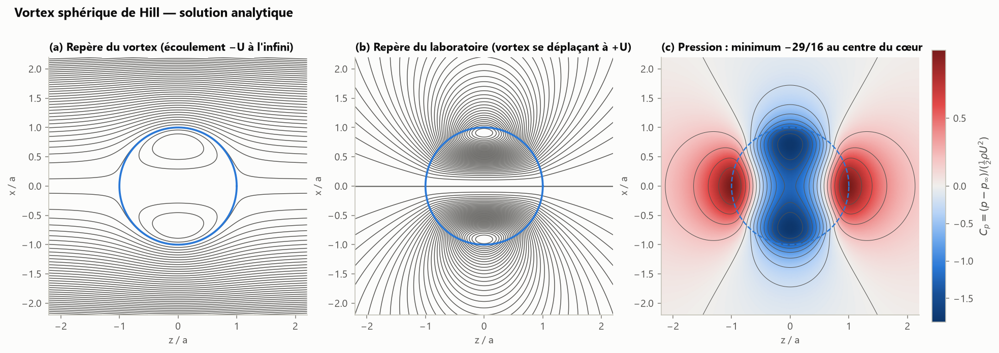

### 2.2 Anneaux minces : formules de Kelvin et de Saffman

Pour un anneau de rayon $R$ et de cœur $a\ll R$, le développement asymptotique raccordé
(Saffman 1970 ; Fraenkel 1972) donne une vitesse qui dépend de la **structure** du cœur :

$$
\boxed{\;U = \frac{\Gamma}{4\pi R}\left[\ln\frac{8R}{a} - \frac{1}{2} + A\right],\qquad
A = \lim_{s\to\infty}\left[\frac{4\pi^2}{\Gamma^2}\int_0^s s'\,v(s')^2\,ds' - \ln\frac{s}{a}\right]\;}
$$

où $v(s)$ est la vitesse azimutale du tourbillon rectiligne équivalent au cœur. On pose $C = \frac12 - A$ :

| Structure du cœur | $C$ | Formule | Référence |
|---|---|---|---|
| vorticité uniforme (Rankine) | $1/4$ | $U = \dfrac{\Gamma}{4\pi R}\left(\ln\dfrac{8R}{a}-\dfrac{1}{4}\right)$ | Kelvin (1867) |
| gaussienne $\omega\propto e^{-s^2/\sigma^2}$ (Lamb–Oseen), $a=\sigma$ | $\frac12+\frac{\ln 2-\gamma_E}{2} = 0{,}558$ | $U = \dfrac{\Gamma}{4\pi R}\left(\ln\dfrac{8R}{\sigma}-0{,}558\right)$ | Saffman (1970) |
| creuse (pression constante) | $1/2$ | $U = \dfrac{\Gamma}{4\pi R}\left(\ln\dfrac{8R}{a}-\dfrac{1}{2}\right)$ | Hicks (1885) |
| filament de Rosenhead–Moore, $a=\delta$ | $1$ | $U = \dfrac{\Gamma}{4\pi R}\left(\ln\dfrac{8R}{\delta}-1\right)$ | § 1.6 |

`theory.core_constant_from_profile` recalcule numériquement ces constantes à partir du profil de
vorticité ($0{,}2500$ et $0{,}5580$ retrouvés).

> **Remarque sur la formule de la feuille de route.** L'expression
> $U = \frac{\Gamma}{4\pi R}\left(\ln\frac{8R}{a}-\frac14\right)$ est la formule de **Kelvin** pour un cœur de vorticité **uniforme**.
> Saffman (1970) l'a généralisée à un cœur quelconque : la constante $-1/4$ devient $-0{,}558$ pour le
> cœur gaussien produit par la diffusion visqueuse. C'est cette version qu'il faut comparer au solveur
> visqueux (§ 2.3). Le code accepte les deux (`theory.ring_speed(..., core="uniform" | "gaussian")`).

**Énergie et principe variationnel.** L'énergie d'un anneau mince vaut
$E = \frac12\rho\Gamma^2R\left[\ln\frac{8R}{a} - 2 + A\right]$ (cœur uniforme : $-7/4$), et son impulsion $I = \pi\rho R^2\Gamma$. À circulation et
volume de cœur fixés ($a^2R$ constant), on vérifie la relation hamiltonienne $U = \partial E/\partial I$, testée
numériquement dans `test_kelvin_benjamin_consistency`. C'est le principe variationnel de Kelvin–Benjamin :
les anneaux stationnaires sont les extrema de l'énergie à impulsion et distribution de vorticité données.

**Famille de Norbury (1973).** Les anneaux stationnaires à $\omega_\theta/r$ constant forment une famille continue
à un paramètre (l'épaisseur relative du cœur). Elle va de l'anneau mince de Kelvin au vortex sphérique de
Hill, qui en est la limite épaisse. L'énergie adimensionnelle $E/(\rho^{1/2}I^{1/2}\Gamma^{3/2})$ décroît le long de la
famille jusqu'à $\approx 0{,}16$ pour Hill (§ 3).

### 2.3 Anneau visqueux : Saffman (1970) et Fukumoto & Moffatt (2000)

Un cœur gaussien diffuse comme un tourbillon de Lamb–Oseen, $\sigma(t)^2 = \sigma_0^2 + 4\nu t$. En l'absence de
cœur initial ($\sigma_0 = 0$), on obtient la **formule de Saffman** :

$$
U(t) = \frac{\Gamma}{4\pi R}\left[\ln\frac{8R}{\sqrt{4\nu t}} - 0{,}558\right].
$$

L'anneau ralentit donc logarithmiquement à mesure que son cœur s'épaissit. Fukumoto & Moffatt (2000) ont
poussé le développement à l'ordre suivant en $\varepsilon^2 = \nu t/R^2$ :

$$
U(t) = \frac{\Gamma}{4\pi R}\left[\ln\frac{4R}{\sqrt{\nu t}} - 0{,}558 - 3{,}6716\,\frac{\nu t}{R^2}\right].
$$

Dans le code (`theory.saffman_speed(..., second_order=True)`), on utilise le temps virtuel
$\nu t = \sigma^2/4$, ce qui permet de traiter un cœur initial fini. La validation du solveur axisymétrique
(§ 4.2) montre que la correction de Fukumoto–Moffatt réduit d'un facteur 2 à 3 l'écart entre simulation
et théorie lorsque $\sigma/R$ atteint 0,3.

### 2.4 Anneaux coaxiaux : saute-mouton et collision frontale

Pour $N$ anneaux minces coaxiaux, décrits par $(R_i(t), Z_i(t))$, on obtient un modèle réduit
(Dyson 1893 ; Hicks 1922) :

$$
\dot Z_i = U_{self}(R_i, a_i) + \sum_{j\neq i} u_z^{(j)}(R_i, Z_i - Z_j), \qquad \dot R_i = \sum_{j\neq i} u_r^{(j)}(R_i, Z_i - Z_j),
$$

avec les vitesses induites exactes du § 1.5 et, éventuellement, la conservation du volume du cœur
$a_i^2R_i = $ cste. L'impulsion totale $\sum_i \pi\rho\Gamma_iR_i^2$ est un invariant exact de ce système
(test `test_coaxial_model_single_ring_and_impulse_invariant`).

* **Saute-mouton (leapfrogging).** Deux anneaux de même sens : l'anneau arrière est contracté et accéléré
  par l'écoulement de l'anneau avant, qui lui est dilaté et ralenti. L'anneau arrière traverse donc le
  premier, puis les rôles s'échangent périodiquement. Le phénomène, décrit par Helmholtz (1858), a été
  analysé par Dyson (1893) et Hicks (1922) ; la stabilité et les « chorégraphies » sont étudiées par
  Borisov, Kilin & Mamaev (2013). Expérimentalement, le saute-mouton ne dure que quelques cycles
  (Riley & Stevens 1993) à cause de la viscosité et des instabilités de Widnall.
* **Collision frontale.** Deux anneaux de sens opposés : par symétrie, le plan médian joue le rôle d'une
  paroi (méthode des images). Les anneaux ralentissent, s'étirent radialement ($R\to\infty$ en fluide parfait)
  et leur vorticité s'intensifie par étirement. En fluide réel, les cœurs finissent par s'annihiler ou se
  reconnecter (Lim & Nickels 1992), ce qu'aucun modèle filamentaire ne peut représenter.

---

## 3. Formation des anneaux : le nombre de formation F* ≈ 4

### 3.1 Générateur piston-cylindre et modèle « slug »

Un piston pousse, à vitesse $U_p$ et sur une course $L$, un « bouchon » (*slug*) de fluide à travers une
buse de diamètre $D$. La couche de cisaillement qui se décolle de la lèvre s'enroule en anneau. Le flux de
circulation à travers la section de sortie vaut $\frac12U_p^2$, d'où le modèle slug :

$$
\Gamma = \tfrac12 U_pL,\qquad I = \rho\,\tfrac{\pi D^2}{4}\,L\,U_p,\qquad E = \tfrac12\rho\,\tfrac{\pi D^2}{4}\,L\,U_p^2 .
$$

Le paramètre de contrôle est la **course adimensionnelle** $L/D$ (temps de formation $t^* = U_pt/D$).

### 3.2 Saturation et détachement (*pinch-off*)

Gharib, Rambod & Shariff (1998) ont montré expérimentalement qu'au-delà de $L/D \approx 4$ l'anneau cesse
d'absorber de la circulation. Il se détache alors du jet générateur et le surplus de vorticité part dans un
jet traînant (*trailing jet*). Cette valeur, le **nombre de formation** $F^*$, est remarquablement universelle :
$F^* \approx 3{,}6$–$4{,}5$ pour des programmes de piston et des nombres de Reynolds variés.

**Explication énergétique (Kelvin–Benjamin).** Un anneau stationnaire de la famille de Norbury ne peut pas
porter une énergie adimensionnelle arbitrairement faible. Or le modèle slug fournit

$$
\alpha(L/D) = \frac{E}{\rho^{1/2}I^{1/2}\Gamma^{3/2}} = \frac{\sqrt{\pi/2}}{L/D},
$$

qui décroît avec la course. Le générateur ne peut donc plus « nourrir » l'anneau quand $\alpha$ passe sous la
valeur critique $\alpha^* \approx 0{,}33$ mesurée par Gharib et al. (1998), et prédite par Mohseni & Gharib (1998) :

$$
\boxed{\;F^* = \frac{\sqrt{\pi/2}}{\alpha^*} \approx 3{,}8 \approx 4\;}
$$

**Critère cinématique (Shusser & Gharib 2000).** De façon équivalente, le détachement survient quand la
vitesse de translation de l'anneau dépasse celle de la couche de cisaillement qui l'alimente, soit environ
$U_p/2$.

**Co-écoulement.** Avec un écoulement ambiant parallèle $U_{co}$ ($R_v = U_{co}/U_j$), Krueger, Dabiri & Gharib (2006)
trouvent que $F$ baisse légèrement mais reste entre 3 et 4 pour $R_v < 0{,}6$, tandis que la circulation de
l'anneau détaché chute d'environ 57 % entre $R_v = 0$ et $0{,}55$.

**Portée pratique.** La formation « optimale » ($L/D \approx F^*$) maximise l'impulsion par unité de volume
éjecté : Krueger & Gharib (2003) montrent que la **poussée moyenne d'une impulsion est maximale pour
$L/D$ juste inférieur à $F^*$**. On retrouve ce principe dans la nage des calmars et des méduses
(Dabiri 2009) et dans le remplissage du ventricule gauche (Gharib et al. 2006). Le rapport
[`vortex_engines_analysis.md`](vortex_engines_analysis.md) en tire les conséquences pour les propulseurs.

---

## 4. Méthodes numériques du projet

### 4.1 Approche A — méthode lagrangienne 3D (`src/vortex_particles.py`)

**Discrétisation.** Chaque anneau est un polygone fermé de $N$ nœuds (marqueurs lagrangiens) portant une
circulation $\Gamma$. Pour un cœur épais, on peut utiliser plusieurs filaments répartis sur des couronnes du
plan méridien, avec des poids gaussiens (Knio & Ghoniem 1990). La vitesse des nœuds est la somme des
contributions de tous les segments, avec l'un des deux noyaux suivants :

* `kernel="segment"` : intégration exacte du noyau de Rosenhead–Moore sur chaque segment (§ 1.6) ;
* `kernel="particle"` : particules vortex (*vortex blobs*) de poids $\boldsymbol{\alpha}_k = \Gamma\,\Delta\mathbf{l}_k$ au milieu des segments.
  Les poids sont recalculés à partir des nœuds : l'étirement est automatique et le théorème de Kelvin est
  satisfait par construction.

**Intégration.** Runge–Kutta classique d'ordre 4 sur $\dot{\mathbf{X}} = \mathbf{u}(\mathbf{X})$. Le coût est en $O(M^2)$ avec un calcul
vectorisé numpy par blocs. Remaillage adaptatif : rééchantillonnage par spline cubique périodique quand un
segment dépasse 1,6 fois le pas cible, ce qui est indispensable en collision où la longueur des filaments
est multipliée par 5 à 10. En option, la conservation du volume du cœur $\delta^2L$ = cste.

**Précision.** L'erreur sur la vitesse propre est pilotée par $\Delta s/\delta$ et décroît à l'ordre 2 ; il faut
$\Delta s \lesssim \delta/2$ pour une erreur de l'ordre du pourcent :

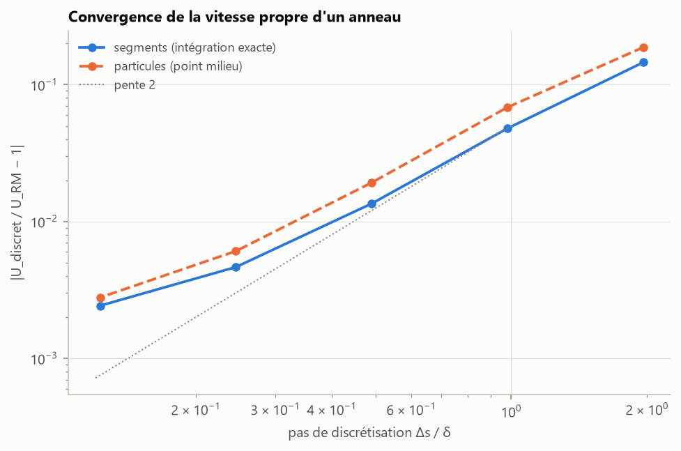

**Validation.**

* Champs analytiques de l'anneau (centre, axe, intégrales elliptiques) et du filament rectiligne infini :
  écarts inférieurs à $2\times10^{-4}$.
* Invariants : sur un cycle de saute-mouton, l'impulsion et l'énergie dérivent de $10^{-4}$ à $10^{-3}$.
* Saute-mouton : l'enveloppe des rayons coïncide avec le modèle coaxial régularisé (§ 2.4).

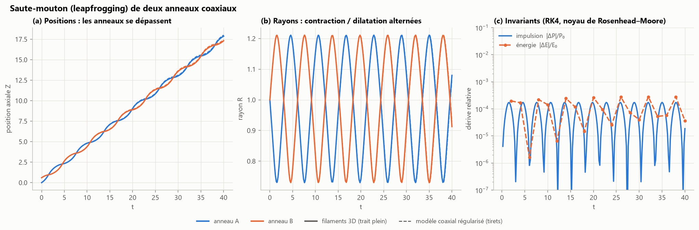

### 4.2 Approche B — Navier–Stokes axisymétrique (`src/solver_2d_axisymmetric.py`)

**Grille.** Maillage cartésien structuré $(r,z)$ **décalé de type MAC** (Harlow & Welch 1965) : pression au
centre des cellules, $u_r$ et $u_z$ sur les faces, $\omega_\theta$ et $\psi$ aux coins. En $r$, le pas est uniforme autour de
l'anneau puis étiré géométriquement, ce qui permet de repousser la paroi glissante à $L_r = 8R$ pour 140
mailles. En $z$, le domaine est périodique.

**Équations discrètes.** Forme conservative des équations de quantité de mouvement en coordonnées
cylindriques, différences centrées d'ordre 2. Le terme visqueux radial s'écrit
$\partial_r[\frac1r\partial_r(ru_r)] = \nabla^2u_r - u_r/r^2$, ce qui traite naturellement le terme en $1/r^2$.

**Méthode de projection** (Chorin 1968). On applique à chaque étage d'un RK4 la projection de Leray discrète :

$$
\frac{d\mathbf{u}}{dt} = \mathbb{P}\,\mathbf{F}(\mathbf{u}),\qquad \mathbb{P} = \mathbf{I} - \mathbf{G}\,(\mathbf{D}\mathbf{G})^{-1}\mathbf{D},
$$

où $\mathbf{D}$ et $\mathbf{G}$ sont la divergence et le gradient discrets, avec $\mathbf{D}\mathbf{G} = \mathbf{L}$ exactement. La divergence reste nulle à
$10^{-12}$ près et la pression est un sous-produit ($p/\rho = \phi$). L'équation de Poisson est résolue
**exactement** : FFT en $z$, puis décomposition spectrale précalculée de l'opérateur radial tridiagonal,
préalablement symétrisé par une matrice diagonale. Il n'y a ni itération ni boucle Python.

**Initialisation.** On impose aux coins la vorticité de Lamb–Oseen
$\omega_\theta = \frac{\Gamma}{\pi a^2}\exp\left(-\frac{(r-R)^2+(z-z_0)^2}{a^2}\right)$, puis on résout la version discrète de
$E^2\psi = -r\omega_\theta$ et on pose $u_r = -\frac1r\partial_z\psi$, $u_z = \frac1r\partial_r\psi$. Le champ initial est à divergence nulle à la
précision machine et son rotationnel discret reproduit la vorticité imposée à $10^{-12}$ près. On peut
aussi initialiser un vortex de Hill (test du solveur de Poisson).

**Validation** (Γ = 1, R = 1, a = 0,2, $Re_\Gamma$ = 1000, Δr = 0,025) :

* **bilan d'énergie** : $E_0 - E(t)$ coïncide avec $\int_0^t\nu\!\int|\boldsymbol{\omega}|^2dV\,dt$ à $\sim10^{-5}$ près. Le schéma centré conservatif
  n'introduit donc aucune dissipation numérique ;
* **convergence** : passer de Δr = 0,025 à 0,0167 change la position de l'anneau à t = 20 de 0,03 %.
  Doubler $L_r$ (8 → 16) ou allonger $L_z$ (10 → 16) la change de moins de 0,6 %. Le confinement et la
  périodicité sont donc négligeables ;
* **vitesse de propagation** : pendant les deux premières unités de temps, le cœur gaussien imposé
  s'ajuste à la géométrie axisymétrique et la vitesse oscille légèrement ; la comparaison n'a de sens
  qu'après ce transitoire. Ensuite, l'écart à la formule de Saffman seule croît avec l'épaississement du
  cœur, tandis que la correction de Fukumoto–Moffatt le réduit d'un facteur 2 à 3 :

  | t | σ/R | simulation vs Saffman | simulation vs Saffman + Fukumoto–Moffatt |
  |---|---|---|---|
  | 5 | 0,24 | −2,5 % | −0,7 % |
  | 10 | 0,28 | −3,8 % | −1,3 % |
  | 15 | 0,32 | −5,3 % | −2,0 % |
  | 20 | 0,35 | −6,8 % | **−2,7 %** |

  L'écart restant correspond aux termes d'ordre supérieur en $(\sigma/R)^2$ et à la déformation non
  gaussienne du cœur. Ce résultat est cohérent avec les simulations spectrales de Stanaway, Cantwell &
  Spalart (1988).

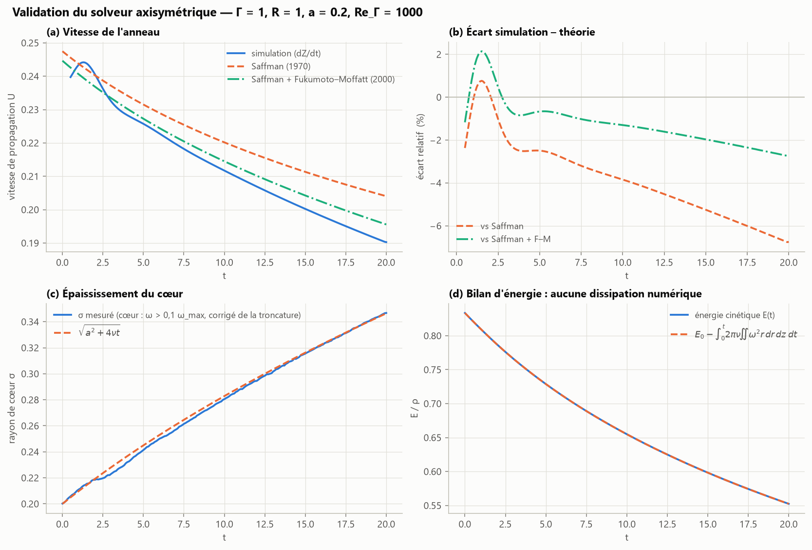

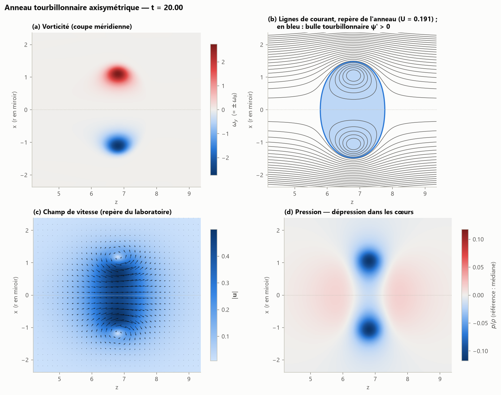

---

## 5. Diagnostics et visualisations avancés

Ces outils sont produits par `python main.py advanced` (et par `all`). Ils sont codés dans
`src/solver_2d_axisymmetric.py` (critères, dissipation, suivi des anneaux), `src/visualization.py` (cartes et
séries) et `src/visualization_3d.py` (vues 3D), et vérifiés par `tests/test_advanced_diagnostics.py`.

### 5.1 Identifier le cœur : critères Q et λ2

Le gradient de vitesse se décompose en déformation et rotation, $\nabla\mathbf{u} = \mathbf{S} + \mathbf{W}$. Le tenseur des taux de rotation
$\mathbf{W}$ est noté $\boldsymbol{\Omega}$ chez Jeong & Hussain ; ici, $\Omega$ est réservé à l'enstrophie (§ 5.2). Deux critères
classiques en déduisent la position des cœurs tourbillonnaires :

* **critère Q** (Hunt, Wray & Moin 1988) : $Q = \tfrac12\left(\|\mathbf{W}\|^2 - \|\mathbf{S}\|^2\right) > 0$, la rotation l'emporte sur la déformation ;
* **critère λ2** (Jeong & Hussain 1995) : la deuxième valeur propre de $\mathbf{S}^2 + \mathbf{W}^2$ est négative, $\lambda_2 < 0$. C'est la
  condition d'un minimum local de pression dans un plan, une fois retirés les effets instationnaires et visqueux.

Dans un écoulement axisymétrique sans swirl, avec $a = \partial_ru_r$, $b = \partial_zu_r$, $c = \partial_ru_z$, $d = \partial_zu_z$ et $e = u_r/r$ :

$$
Q = -\tfrac12\left(a^2 + d^2 + e^2\right) - bc .
$$

Le bloc $(r,z)$ de $\mathbf{S}^2 + \mathbf{W}^2$ se diagonalise analytiquement et la composante azimutale vaut $e^2$ ; $\lambda_2$ est la médiane
des trois valeurs propres. Pour un fluide incompressible, la divergence de l'équation de Navier–Stokes donne
$\nabla^2p/\rho = 2Q$ : les zones de Q élevé sont des creux de pression.

**Validation.** Dans le vortex de Hill, Q > 0 et λ2 < 0 au centre du cœur ($r = a/\sqrt2$). À l'extérieur de la sphère
($\rho > 1{,}3\,a$, loin de la discontinuité de vorticité), l'écoulement est potentiel : Q < 0 et λ2 > 0. Pour un anneau de
Lamb–Oseen, $\tfrac12\nabla^2p$ discret et Q coïncident à 0,4 % près dans le cœur.

**Reconstruction par révolution.** Un champ axisymétrique $f(r,z)$ définit le champ 3D $f(\sqrt{x^2+y^2},\,z)$ ; `revolve_field`
l'échantillonne sur une grille cartésienne par interpolation bilinéaire du plan méridien. Pour les isosurfaces, aucun
algorithme de type *marching cubes* n'est nécessaire : l'isosurface 3D est exactement la surface de révolution de
l'iso-contour méridien. Le contour, extrait par `contourpy`, est donc tourné autour de l'axe. Un secteur de 90° est
retiré face à la caméra : les faces de coupe montrent l'intérieur du cœur. On obtient la « peau toroïdale » du vortex,
colorée par $|\mathbf{u}|$ ou par la dépression $-(p-p_\infty)/\rho$.

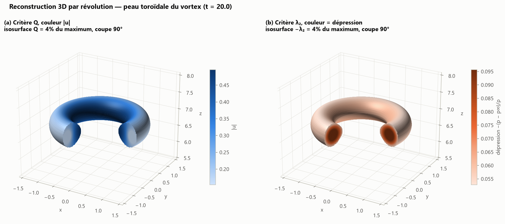

Q et λ2 donnent ici des surfaces presque identiques, ce qui est attendu pour un anneau isolé. Leurs
différences n'apparaissent que dans des écoulements fortement déformés (Chakraborty, Balachandar & Adrian 2005). La
coloration montre que la vitesse est maximale sur la face intérieure du tore, où les vitesses induites par le cœur
et par le reste de l'anneau s'additionnent. La coupe de l'isosurface λ2 montre, elle, une dépression maximale au
centre de chaque cœur.

### 5.2 Où l'énergie devient chaleur : dissipation Φ et bilan d'énergie

Le taux local de dissipation visqueuse est la puissance transformée en chaleur par unité de volume :

$$
\Phi = 2\mu\,\mathbf{S}:\mathbf{S} = 2\mu\left[a^2 + d^2 + e^2 + \tfrac12(b+c)^2\right] \;\ge 0 .
$$

Pour un fluide incompressible, $2\,\mathbf{S}:\mathbf{S} = |\boldsymbol{\omega}|^2 + 2\nabla\cdot\left[(\mathbf{u}\cdot\nabla)\mathbf{u}\right]$. Le terme de divergence s'intègre en un flux de
bord, nul pour un domaine périodique à paroi glissante. On en déduit

$$
\int\Phi\,dV = \mu\int|\boldsymbol{\omega}|^2dV = \mu\,\Omega,\qquad \frac{dE_k}{dt} = -\nu\,\Omega ,\qquad \frac{dP_z}{dt} = 0 .
$$

Ici $\Omega = \int|\boldsymbol{\omega}|^2dV$ désigne l'enstrophie globale. La simulation vérifie la première égalité à $2\times10^{-6}$ près en
valeur relative. Localement, en revanche, $\Phi$ et $\mu\omega^2$ diffèrent beaucoup. Au
centre d'un cœur de Lamb–Oseen, la rotation est solide et la dissipation est nulle. Φ est maximale sur une
couronne où $\left[s\,\partial_s(u_\theta/s)\right]^2$ culmine, c'est-à-dire à $s = 1{,}34\,a$ du centre du cœur ($x = s^2/a^2$ vérifie
$x^2 + x + 1 = e^x$). Elle s'annule aussi au point d'arrêt situé sur l'axe au centre de l'anneau, et décroît comme
$r^{-8}$ loin de l'anneau.

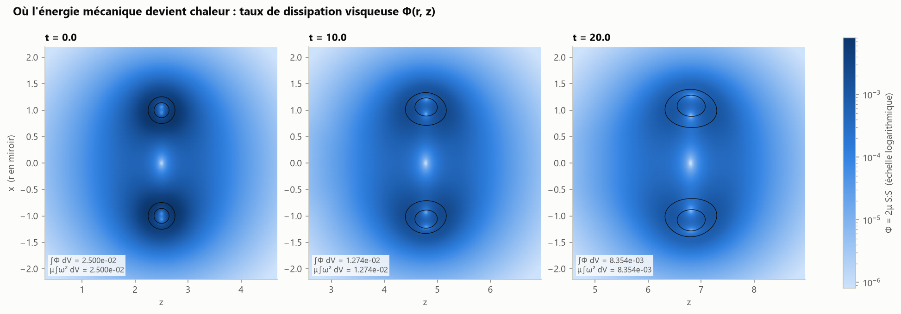

**Bilan temporel.** La figure compare $E_k(t)$ à la décroissance visqueuse théorique $E_0 - \nu\int_0^t\Omega\,dt$, calculée avec
l'enstrophie mesurée. Pour l'anneau à $Re_\Gamma = 1000$, 34 % de l'énergie est dissipée en 20 unités de temps. L'écart
entre les deux courbes reste inférieur à $8\times10^{-6}\,E_0$, soit $2\times10^{-5}$ de l'énergie perdue. Le schéma centré
conservatif n'ajoute donc pas de dissipation numérique mesurable. L'impulsion reste constante et l'enstrophie
décroît plus vite que l'énergie, parce que le cœur s'épaissit.

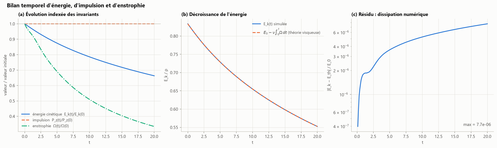

### 5.3 Diagrammes de Hovmöller z–t

Un diagramme de Hovmöller (Hovmöller 1949, en météorologie) représente une grandeur réduite à une dimension
d'espace, ici $z$, en fonction du temps. Deux grandeurs sont tracées : l'intensité maximale $\max_r\omega_\theta(z,t)$ et la
dépression maximale $-\min_r(p-p_\infty)/\rho$. Chaque anneau y trace une bande dont la pente locale $dz/dt$ est sa vitesse
instantanée. Pour l'anneau unique, la bande se redresse vers la verticale (ralentissement) et pâlit (étalement de la
vorticité). Elle suit la trajectoire $Z_0 + \int U_{\text{Saffman+FM}}\,dt$ : à $t = 20$, l'anneau simulé n'a que 0,05 de retard pour
4,27 parcourus (1,2 %).

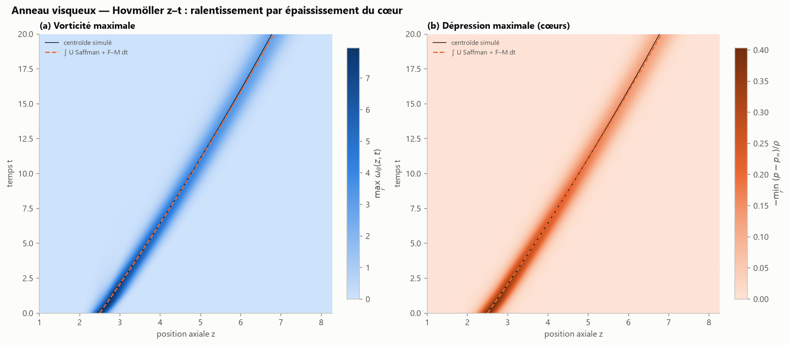

Pour les filaments (fluide parfait), la grandeur tracée est la densité axiale lissée de vorticité
$\lambda(z,t) = \sum_k|\Gamma_k|\,\ell_k\,G_\delta(z-z_k)$, dont l'intégrale vaut $\sum|\Gamma|\times$ longueur. En saute-mouton, les deux bandes
se croisent périodiquement sans jamais se confondre : sans viscosité, les cœurs gardent leur taille et ne
fusionnent pas. Comparer avec le § 5.4.

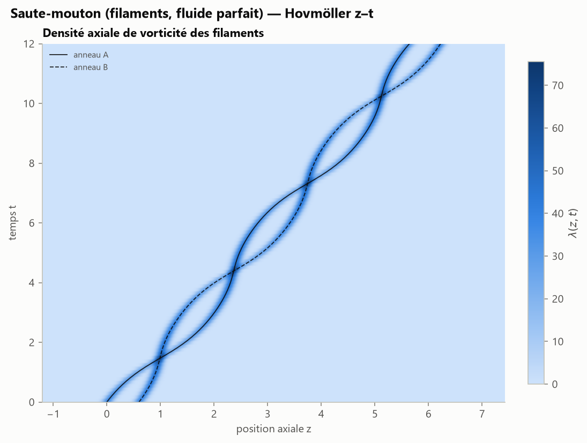

### 5.4 Saute-mouton visqueux et espace des phases

Deux anneaux identiques ($R = 1$, $\Gamma = 1$, cœurs gaussiens $\sigma_0 = 0{,}10$, écart initial 0,6) sont simulés par le
solveur Navier–Stokes à $Re_\Gamma = 3000$, avec suivi individuel des cœurs. Les maxima de vorticité sont
identifiés, puis le domaine est partagé entre les pics et on calcule les moments de Saffman de chaque partie.

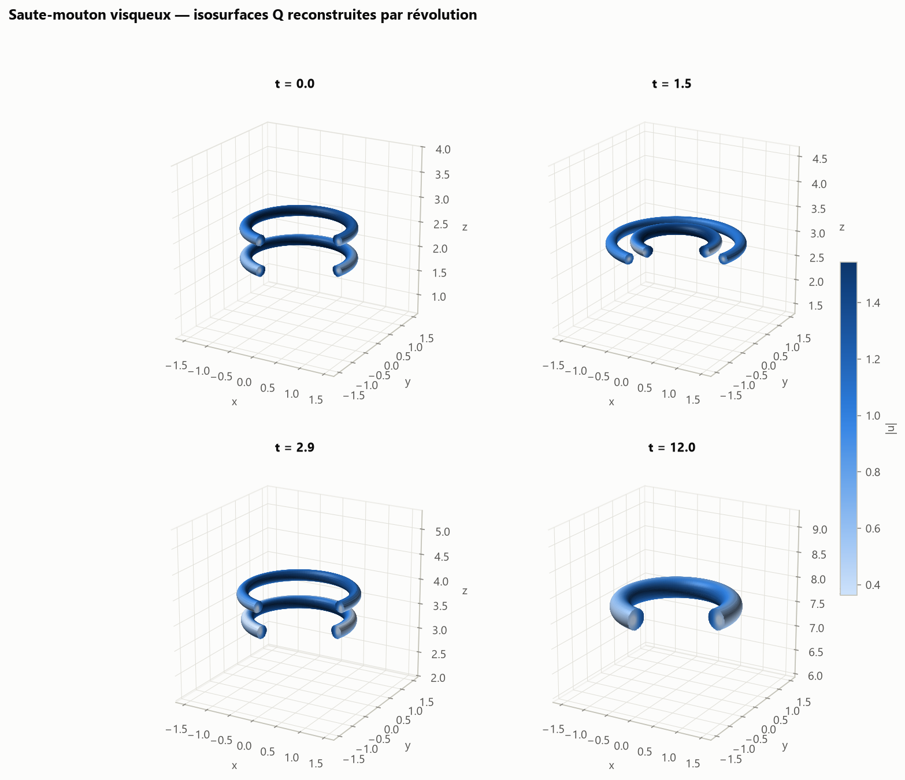

Sur le Hovmöller, les deux bandes se tressent : l'anneau arrière, contracté, accélère et traverse l'anneau avant, qui
se dilate et ralentit. Les traversées ont lieu à t = 1,45 et 3,92 (modèle coaxial non visqueux : 1,47 et 4,40).
Les cœurs fusionnent ensuite à t ≈ 5,4, et une seule bande subsiste.

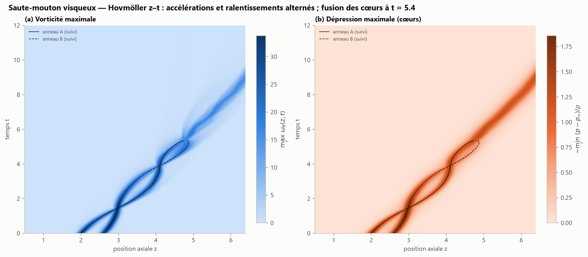

**Portrait de phase.** Dans le plan $(R_1-R_2,\;z_1-z_2)$, le saute-mouton non visqueux est une **orbite fermée**
(dynamique périodique). La simulation filamentaire 3D, avec le δ équivalent au cœur gaussien (§ 1.6), et le modèle
coaxial régularisé (§ 2.4) parcourent la même orbite, à l'épaisseur du trait près. Leurs traversées
(1,46 ; 4,39 ; 7,32 ; 10,24 pour les filaments) coïncident à 0,2 % près. La trajectoire Navier–Stokes
s'en écarte après la première traversée. Elle **spirale vers l'intérieur**, avec des oscillations de rayon d'amplitude
décroissante et une période raccourcie, jusqu'à la capture.

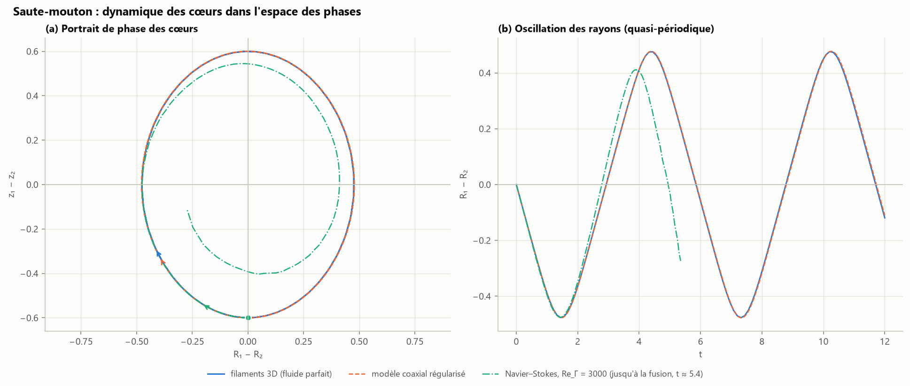

**Pourquoi les cœurs fusionnent.** Lors d'une traversée, les deux cœurs de même signe forment localement une paire
co-rotative, séparée de $b \approx |R_1 - R_2|$. Deux tourbillons co-rotatifs fusionnent quand le rapport entre rayon de cœur et
séparation dépasse une valeur critique, $(a/b)_c \approx 0{,}22$–$0{,}24$ (Meunier et al. 2002 ; Meunier, Le Dizès & Leweke 2005),
soit $b/\sigma \lesssim 4$. Ici $\sigma^2 = \sigma_0^2 + 4\nu t$. À la première traversée, $b \approx 0{,}47$ et $\sigma \approx 0{,}109$, soit $b/\sigma \approx 4{,}3$ :
les anneaux survivent. À la seconde, l'orbite s'est contractée ($b \approx 0{,}41$) et le cœur s'est épaissi
($\sigma \approx 0{,}123$), soit $b/\sigma \approx 3{,}3$. La paire passe sous le seuil et fusionne dans l'intervalle suivant.

Les cartes de dissipation montrent que les pertes se concentrent autour des cœurs, avec des points d'arrêt (Φ ≈ 0)
entre eux lors de la traversée. Le bilan donne 14 % d'énergie dissipée en 12 unités de temps, pour un
résidu de $1{,}7\times10^{-6}\,E_0$. L'enstrophie chute de 67 %, avec une baisse marquée pendant la fusion.

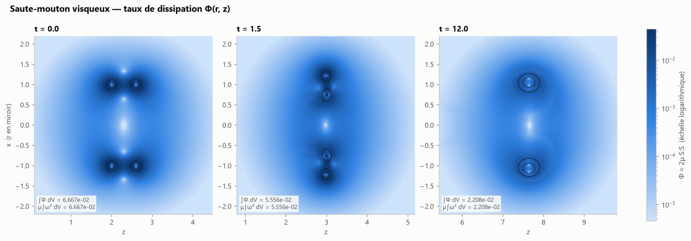

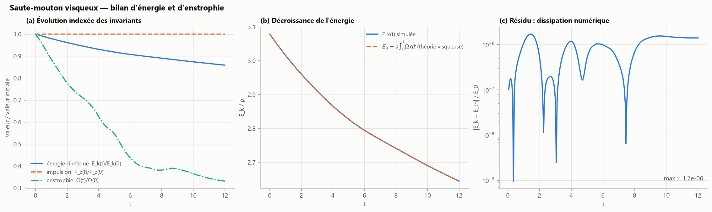

### 5.5 Tubes de vorticité (filaments 3D)

Chaque filament lagrangien est dessiné comme un tube lisse. La ligne centrale est une spline cubique périodique.
Le repère le long du tube est obtenu par **transport parallèle** (Bishop 1975), qui évite la torsion parasite du repère de
Frenet et reste défini sur les portions droites. L'écart angulaire résiduel après un tour (holonomie) est réparti
le long de la courbe pour que le tube se referme sans couture. Le rayon du tube est proportionnel au δ courant du
filament. Avec l'option de conservation du volume de cœur $\delta^2L$, δ diminue quand le filament s'étire. La couleur code Γ : palette divergente si les
deux signes sont présents, demi-palette sinon.

Pour un anneau à cœur épais (1 + 6 + 12 filaments de poids gaussiens), un écorché de 110° montre la section
du cœur : filaments centraux intenses et foncés, couronnes externes plus claires. En collision frontale, les tubes
s'amincissent à mesure que les anneaux s'étirent radialement.

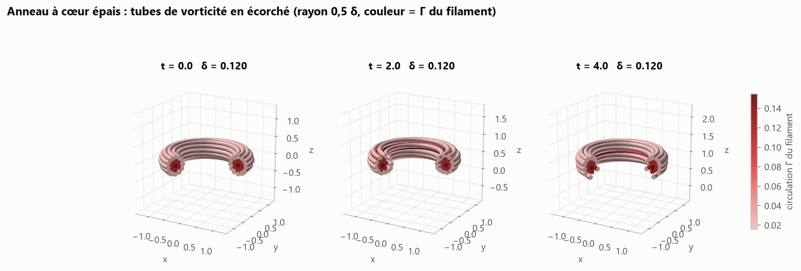

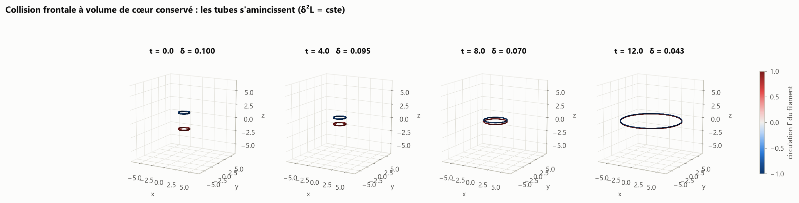

### 5.6 Rendu volumique de l'enstrophie (« fumée synthétique »)

On note $V = \tfrac12\omega^2$ la densité d'enstrophie et $\hat V = (V/V_{max})^\gamma$ sa valeur normalisée, avec un contraste γ.
$\hat V$ est rendu par lancer de rayons orthographique selon le modèle d'émission-absorption (Levoy 1988 ; Max 1995).
Le long de chaque rayon, de l'avant vers l'arrière :

$$
\alpha_k = 1 - e^{-\kappa\,\hat V_k\,\Delta s},\qquad C \mathrel{+}= T\,\alpha_k\,c(\hat V_k)\,L_k,\qquad T \mathrel{*}= (1-\alpha_k),
$$

puis l'image vaut $C + T\times$ fond. κ (paramètre `density`) règle l'opacité et $c$ est la palette « fumée ».
L'éclairage $L_k$ est un terme ambiant auquel s'ajoute un terme de Lambert ; la normale locale vaut
$-\nabla\hat V/|\nabla\hat V|$. Pour le solveur axisymétrique, le volume est obtenu par révolution. Pour
les filaments, la vorticité est reconstruite sur une grille (« splatting ») : chaque segment devient une particule
de poids $\Gamma\,\Delta\mathbf{l}$, répartie selon la distribution associée au noyau de Rosenhead–Moore,
$\zeta_\delta(\rho) = \frac{3}{4\pi\delta^3}\left(1+\rho^2/\delta^2\right)^{-5/2}$ (d'intégrale 1). Les filaments sont d'abord rééchantillonnés finement, pour
supprimer l'aspect perlé. Quand les anneaux s'étalent, la grille grandit et son pas $h$ aussi. Le δ de rendu est
alors porté à au moins $2h$ (anti-crénelage), faute de quoi un tube trop fin pour la grille apparaîtrait en
pointillés ; la circulation n'est pas modifiée.

**Validation.** Une dalle homogène d'épaisseur $L$ donne une transmittance $e^{-\kappa L}$ à $5\times10^{-4}$ près. Le flux de la
vorticité reconstruite à travers un demi-plan méridien vaut Γ, aux queues du noyau près ; ces queues décroissent
lentement, la fraction du flux au-delà de ρ étant $\delta^2/(\delta^2+\rho^2)$.

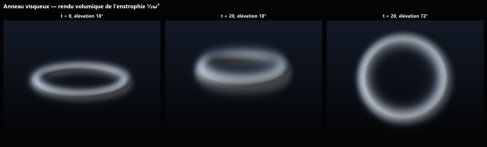

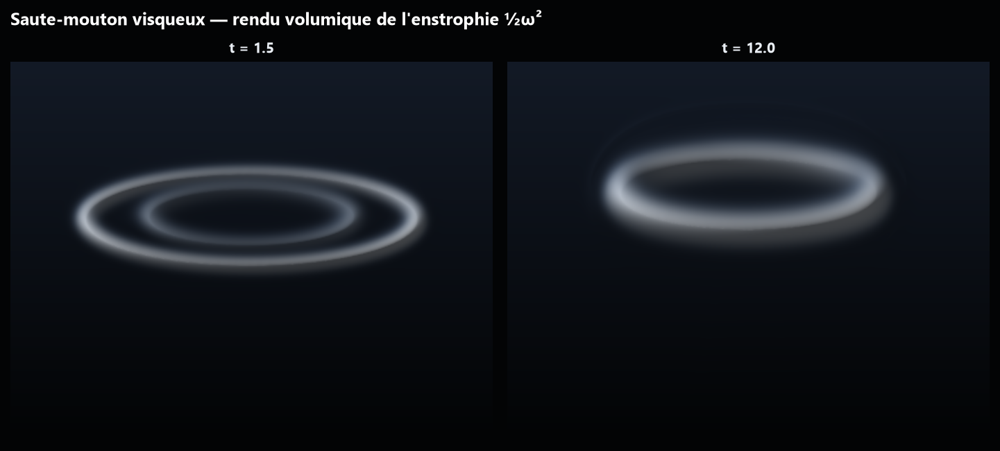

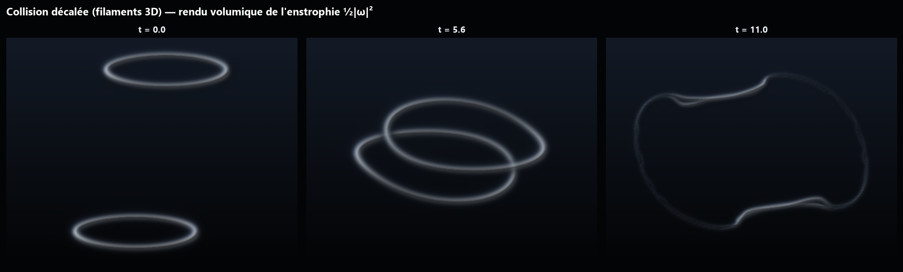

L'option `--smoke-video` produit l'animation `outputs/animations/smoke_rings_leapfrog.mp4` du saute-mouton des
filaments en rendu volumique.

---

## 6. Références

* Arms, R. J. & Hama, F. R. (1965). Localized-induction concept on a curved vortex and motion of an elliptic vortex ring. *Phys. Fluids* 8, 553–559.
* Batchelor, G. K. (1967). *An Introduction to Fluid Dynamics*. Cambridge University Press.
* Bishop, R. L. (1975). There is more than one way to frame a curve. *Amer. Math. Monthly* 82, 246–251.
* Borisov, A. V., Kilin, A. A. & Mamaev, I. S. (2013). The dynamics of vortex rings: leapfrogging, choreographies and the stability problem. *Regul. Chaotic Dyn.* 18, 33–62.
* Chakraborty, P., Balachandar, S. & Adrian, R. J. (2005). On the relationships between local vortex identification schemes. *J. Fluid Mech.* 535, 189–214.
* Chorin, A. J. (1968). Numerical solution of the Navier–Stokes equations. *Math. Comp.* 22, 745–762.
* Cottet, G.-H. & Koumoutsakos, P. (2000). *Vortex Methods: Theory and Practice*. Cambridge University Press.
* Dabiri, J. O. (2009). Optimal vortex formation as a unifying principle in biological propulsion. *Annu. Rev. Fluid Mech.* 41, 17–33.
* Dyson, F. W. (1893). The potential of an anchor ring. Part II. *Phil. Trans. R. Soc. A* 184, 1041–1106.
* Fraenkel, L. E. (1972). Examples of steady vortex rings of small cross-section in an ideal fluid. *J. Fluid Mech.* 51, 119–135.
* Fukumoto, Y. & Moffatt, H. K. (2000). Motion and expansion of a viscous vortex ring. Part 1. A higher-order asymptotic formula for the velocity. *J. Fluid Mech.* 417, 1–45.
* Gharib, M., Rambod, E. & Shariff, K. (1998). A universal time scale for vortex ring formation. *J. Fluid Mech.* 360, 121–140.
* Gharib, M., Rambod, E., Kheradvar, A., Sahn, D. J. & Dabiri, J. O. (2006). Optimal vortex formation as an index of cardiac health. *PNAS* 103, 6305–6308.
* Harlow, F. H. & Welch, J. E. (1965). Numerical calculation of time-dependent viscous incompressible flow of fluid with free surface. *Phys. Fluids* 8, 2182–2189.
* Hicks, W. M. (1885). Researches on the theory of vortex rings. Part II. *Phil. Trans. R. Soc.* 176, 725–780.
* Hicks, W. M. (1922). On the mutual threading of vortex rings. *Proc. R. Soc. A* 102, 111–131.
* Hill, M. J. M. (1894). On a spherical vortex. *Phil. Trans. R. Soc. A* 185, 213–245.
* Hovmöller, E. (1949). The trough-and-ridge diagram. *Tellus* 1, 62–66.
* Hunt, J. C. R., Wray, A. A. & Moin, P. (1988). Eddies, streams, and convergence zones in turbulent flows. *Center for Turbulence Research, Proc. Summer Program 1988*, 193–208.
* Jeong, J. & Hussain, F. (1995). On the identification of a vortex. *J. Fluid Mech.* 285, 69–94.
* Kelvin, Lord (W. Thomson) (1867). On vortex atoms. *Phil. Mag.* 34, 15–24.
* Knio, O. M. & Ghoniem, A. F. (1990). Numerical study of a three-dimensional vortex method. *J. Comput. Phys.* 86, 75–106.
* Krueger, P. S. & Gharib, M. (2003). The significance of vortex ring formation to the impulse and thrust of a starting jet. *Phys. Fluids* 15, 1271–1281.
* Krueger, P. S., Dabiri, J. O. & Gharib, M. (2006). The formation number of vortex rings formed in uniform background co-flow. *J. Fluid Mech.* 556, 147–166.
* Lamb, H. (1932). *Hydrodynamics*, 6th ed. Cambridge University Press.
* Leonard, A. (1980). Vortex methods for flow simulation. *J. Comput. Phys.* 37, 289–335.
* Levoy, M. (1988). Display of surfaces from volume data. *IEEE Comput. Graph. Appl.* 8, 29–37.
* Lim, T. T. & Nickels, T. B. (1992). Instability and reconnection in the head-on collision of two vortex rings. *Nature* 357, 225–227.
* Max, N. (1995). Optical models for direct volume rendering. *IEEE Trans. Vis. Comput. Graph.* 1, 99–108.
* Meunier, P., Ehrenstein, U., Leweke, T. & Rossi, M. (2002). A merging criterion for two-dimensional co-rotating vortices. *Phys. Fluids* 14, 2757–2766.
* Meunier, P., Le Dizès, S. & Leweke, T. (2005). Physics of vortex merging. *C. R. Physique* 6, 431–450.
* Mohseni, K. & Gharib, M. (1998). A model for universal time scale of vortex ring formation. *Phys. Fluids* 10, 2436–2438.
* Moore, D. W. (1972). Finite amplitude waves on aircraft trailing vortices. *Aeronaut. Q.* 23, 307–314.
* Norbury, J. (1973). A family of steady vortex rings. *J. Fluid Mech.* 57, 417–431.
* Riley, N. & Stevens, D. P. (1993). A note on leapfrogging vortex rings. *Fluid Dyn. Res.* 11, 235–244.
* Rosenhead, L. (1930). The spread of vorticity in the wake behind a cylinder. *Proc. R. Soc. A* 127, 590–612.
* Saffman, P. G. (1970). The velocity of viscous vortex rings. *Stud. Appl. Math.* 49, 371–380.
* Saffman, P. G. (1992). *Vortex Dynamics*. Cambridge University Press.
* Shariff, K. & Leonard, A. (1992). Vortex rings. *Annu. Rev. Fluid Mech.* 24, 235–279.
* Shusser, M. & Gharib, M. (2000). Energy and velocity of a forming vortex ring. *Phys. Fluids* 12, 618–621.
* Stanaway, S. K., Cantwell, B. J. & Spalart, P. R. (1988). A numerical study of viscous vortex rings using a spectral method. *NASA TM* 101041.
* Widnall, S. E. & Sullivan, J. P. (1973). On the stability of vortex rings. *Proc. R. Soc. A* 332, 335–353.
* Winckelmans, G. S. & Leonard, A. (1993). Contributions to vortex particle methods for the computation of three-dimensional incompressible unsteady flows. *J. Comput. Phys.* 109, 247–273.
