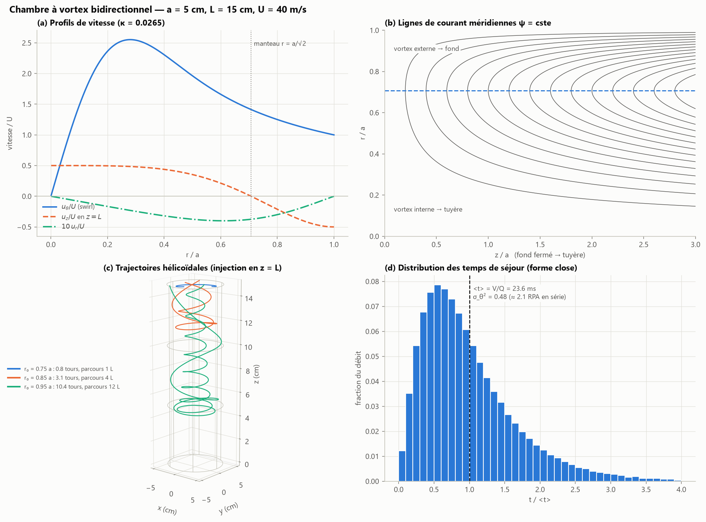
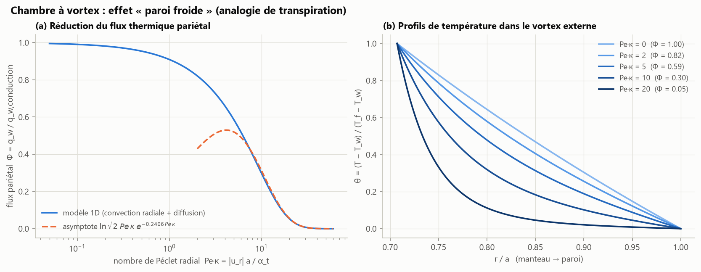
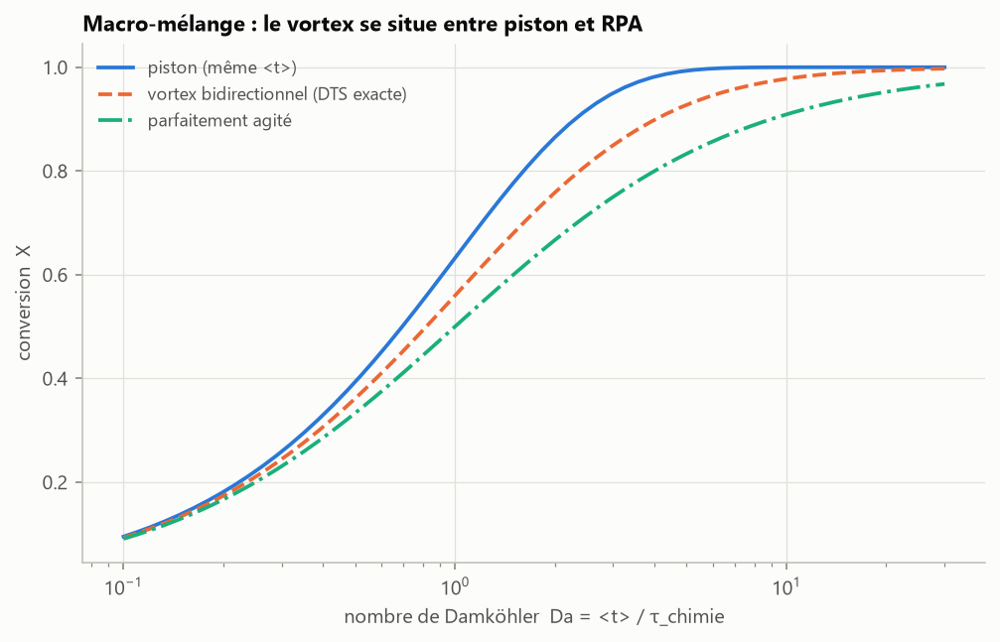
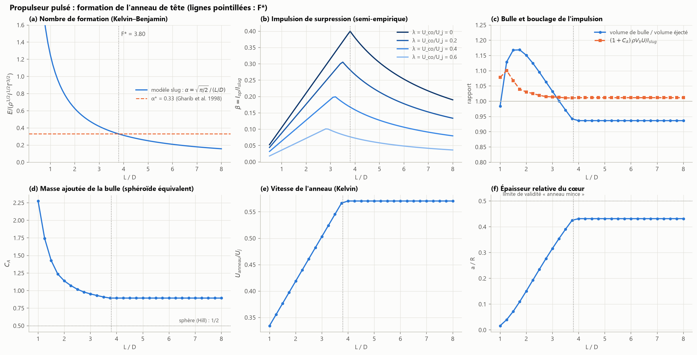
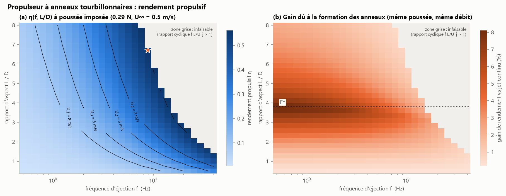

# Analyse physique des moteurs à vortex — rapport de synthèse

> Les chiffres des §§ 1 à 2.3 sont produits par `src/engine_analysis.py` (`python main.py engines`) et repris de
> `outputs/summary.json`. Ceux du § 2.4 viennent des simulations de `python main.py axisym` et `advanced`. La
> théorie des anneaux est détaillée dans [`theoretical_background.md`](theoretical_background.md).

## Résumé

| Résultat | Valeur (cas d'exemple) |
|---|---|
| Temps de séjour le long d'une ligne de courant (vortex bidirectionnel) | **forme close** $t(r_0) = \frac{a}{\pi\kappa U}\ln\tan\frac{\pi r_0^2}{2a^2}$ |
| Temps de séjour moyen | $= V/Q$ = 23,6 ms (identique à un réacteur piston de même volume) |
| Dispersion des temps de séjour | $\sigma_\theta^2 = 0{,}485$ (≈ 2 réacteurs agités en série) |
| Parcours hélicoïdal | jusqu'à 12 L et 10 tours (fluide injecté à r₀ = 0,95 a) |
| Alimentation du cœur à travers le manteau | uniforme : $Q/L$ par unité de longueur |
| Flux pariétal « paroi froide » | $\Phi \approx \ln\sqrt2\;Pe\,\kappa\;e^{-0{,}2406\,Pe\,\kappa}$ ; Φ = 0,30 pour Pe·κ = 10 |
| Nombre de formation | $F^* = \sqrt{\pi/2}/\alpha^* = 3{,}80$ |
| Impulsion de surpression | maximale à L/D = F* (+40 % de l'impulsion slug) |
| Gain de rendement vs jet continu (même poussée, même débit) | jusqu'à **8,1 %**, à L/D ≈ 3,9 |
| Sillage : interaction d'anneaux successifs (§ 2.4) | fusion des cœurs après deux traversées quand séparation / rayon de cœur < ≈ 4 |

---

## 1. Chambres de combustion à vortex

### 1.1 Principe

Dans une chambre à « paroi froide » (*vortex combustion cold-wall*, Chiaverini et al. 2002), le comburant
est injecté **tangentiellement** près de la tuyère. Il descend en spirale le long de la paroi jusqu'au fond
fermé (vortex externe), se retourne, puis remonte en spirale vers la tuyère au cœur de la chambre (vortex
interne). La combustion a lieu dans le vortex interne ; la paroi reste baignée de comburant froid. Le même
écoulement a été exploité dans des moteurs hybrides, où le swirl augmente fortement la vitesse de
régression du combustible solide (Knuth et al. 2002).

### 1.2 Modèle : solution exacte de Vyas & Majdalani (2006)

Pour une chambre de rayon $a$ et de longueur $L$, avec une vitesse d'injection $U$ et un débit $Q$
(avec $\tilde r = r/a$ et $\tilde z = z/a$) :

$$
\psi = Ua^2\kappa\,\tilde z\sin(\pi\tilde r^2),\qquad u_r = -\frac{U\kappa\sin(\pi\tilde r^2)}{\tilde r},\qquad
u_z = 2\pi U\kappa\,\tilde z\cos(\pi\tilde r^2),\qquad \kappa = \frac{Q}{2\pi UaL}.
$$

La vitesse de swirl est $u_\theta = U/\tilde r$, régularisée par un noyau de type Burgers de rayon $0{,}25a$.
Le **manteau** $u_z = 0$ se situe en $r = a/\sqrt2$.

Cas d'exemple : a = 5 cm, L = 15 cm, U = 40 m/s, Q = 0,05 m³/s, d'où κ = 0,0265. On obtient une chute de
pression paroi → axe de 3,4 bar (équilibre radial, ρ = 20 kg/m³) et un nombre de swirl en sortie S = 2,9.

### 1.3 Confinement hélicoïdal et temps de séjour

La conservation de ψ le long des trajectoires donne trois résultats analytiques. Ils sont vérifiés par
intégration des équations de trajectoire, où ψ est conservé à 1e-9.

* **Profondeur de pénétration** : le fluide entrant en $r_0$ descend jusqu'à $z_{min} = L\sin(\pi\tilde r_0^2)$.
  Plus il entre près de la paroi, plus il atteint le fond.
* **Rayon de sortie** : $\tilde r_1 = \sqrt{1-\tilde r_0^2}$.
* **Temps de séjour** : $dt = dr/u_r$ s'intègre en forme close, $t(r_0) = \frac{a}{\pi\kappa U}\ln\tan\frac{\pi\tilde r_0^2}{2}$.

On pondère par le débit entrant, $\propto|\cos\pi\tilde r_0^2|\,d(\tilde r_0^2)$. Une intégration par parties donne
exactement $\langle t\rangle = a/(2\kappa U) = V/Q$ : conformément au théorème de Danckwerts, **le vortex
n'allonge pas le temps de séjour moyen**. Il en élargit en revanche la distribution ($\sigma_\theta^2 = 0{,}485$, soit
un macro-mélange équivalent à environ 2 réacteurs agités en série) et il allonge considérablement le
chemin parcouru :

| r₀ / a | temps de séjour | tours | parcours |
|---|---|---|---|
| 0,75 | 3,0 ms | 0,8 | 1,1 L |
| 0,85 | 11,5 ms | 3,1 | 4,5 L |
| 0,95 | 28,0 ms | 10,4 | 12,0 L |

**Alimentation distribuée.** Le débit qui franchit le manteau vaut $2\pi r_m|u_r(r_m)| = Q/L$ par unité de
longueur, uniforme sur toute la chambre. Le vortex externe se comporte donc comme un **injecteur réparti**
qui dose le comburant dans la zone de combustion sur toute sa longueur, sans point chaud localisé.

### 1.4 Refroidissement pariétal : l'effet « paroi froide »

Entre la flamme (au manteau, $T_f$) et la paroi ($T_w$), la chaleur est transportée par diffusion turbulente
$\alpha_t$. Elle est en même temps repoussée vers le cœur par l'aspiration radiale $u_r<0$ du vortex externe.
L'équation 1D $u_r\,T' = \alpha_t\,\frac1r(rT')'$ s'intègre exactement avec la fonction sinus intégral Si :

$$
\Phi = \frac{q_w}{q_{w,\text{conduction}}} = \frac{\ln(1/\tilde r_f)}{\int_{\tilde r_f}^1 e^{g(s)}\,ds/s},\qquad
g(s) = \frac{Pe\,\kappa}{2}\left[\mathrm{Si}(\pi)-\mathrm{Si}(\pi s^2)\right],\qquad Pe = \frac{Ua}{\alpha_t}.
$$

Pour $Pe\,\kappa \gg 1$, la méthode de Laplace donne $\Phi \approx \ln\sqrt2\;Pe\,\kappa\;e^{-0{,}2406\,Pe\,\kappa}$. L'aspiration radiale joue le
rôle d'un **refroidissement par transpiration** : le nombre de Péclet radial $Pe\,\kappa = |u_r|a/\alpha_t$ pilote seul
l'isolation.

| Pe·κ | 1 | 2 | 5 | 10 | 20 |
|---|---|---|---|---|---|
| Φ | 0,91 | 0,82 | 0,59 | 0,30 | 0,05 |

Le comburant froid, plus dense, est plaqué à la paroi par la force centrifuge. Cette stratification est
stable au sens de Rayleigh et réduit $\alpha_t$ près de la paroi : l'effet paroi froide se renforce
lui-même, ce qui est cohérent avec les parois quasi ambiantes rapportées lors des essais.

### 1.5 Efficacité de mélange et de combustion

* **Macro-mélange** : pour une réaction d'ordre 1 à temps de séjour moyen égal, la conversion du vortex
  se situe entre celles du réacteur piston et du réacteur agité. L'avantage du vortex n'est donc **pas**
  un temps de séjour plus long. Il tient à la stabilisation de flamme par rétro-mélange, à l'alimentation
  répartie et au fort cisaillement du swirl au manteau, qui favorise le micro-mélange.
* **Rétention centrifuge des gouttes** : une goutte reste piégée dans le vortex externe si
  $d > d_c = \sqrt{9\mu\kappa a/(\rho_l U)}$, soit 4,3 µm ici. Pratiquement tout un spray reste confiné jusqu'à
  évaporation, ce qui permet des chambres compactes.

**Limites.** La solution est non visqueuse et incompressible, sans dégagement de chaleur ; la diffusivité
turbulente $\alpha_t$ est incertaine (un facteur 5 sur Pe fait passer Φ de 0,8 à 0,2). Il s'agit d'outils de
dimensionnement et de compréhension, pas d'une prédiction CFD réactive.

---

## 2. Propulsion pulsée par anneaux tourbillonnaires

### 2.1 Impulsion d'une éjection

Une éjection de course $L$ à vitesse $U_j$ par une tuyère $D$ fournit l'impulsion slug $I_s = \rho\frac{\pi D^2}{4}LU_j$. Le
fluide ambiant accéléré pendant la formation de l'anneau crée une **surpression** à la sortie qui
s'y ajoute (Krueger & Gharib 2003). On la modélise par $I = I_s(1+\beta)$ avec une fermeture semi-empirique :
$I_{op}\propto$ (volume de l'anneau) × (vitesse) $\propto L^2$ pendant la formation, puis l'impulsion se fige au
détachement :

$$
\beta = \beta_{max}\,\frac{L/D}{F^*}\ (L/D\le F^*),\qquad \beta = \beta_{max}\,\frac{F^*}{L/D}\ (L/D>F^*),\qquad \beta_{max}\approx0{,}4 .
$$

Le maximum à $L/D = F^* = 3{,}80$ reproduit l'observation de Krueger & Gharib : la poussée moyenne est
maximale pour une course juste inférieure au nombre de formation. Un co-écoulement de rapport λ réduit
β d'un facteur $(1-\lambda)^2(1+\lambda)$ et abaisse F* d'environ 25 % à λ = 0,6 (Krueger, Dabiri & Gharib 2006).

### 2.2 Anneau de tête, bulle et masse ajoutée

Le modèle slug donne le rayon de l'anneau, $R = D/\sqrt2$ (via $I = \pi\rho R^2\Gamma$). L'énergie fixe le cœur, et
Kelvin la vitesse propre. La **bulle** transportée par l'anneau est délimitée par la séparatrice $\psi - UR^2/2 = 0$ ;
on l'assimile à un sphéroïde équivalent pour obtenir la masse ajoutée $C_A$ (Lamb § 373).

| L/D | Γ/(U_j D) | U_anneau/U_j | a/R | V_bulle/V_éjecté | C_A | (1+C_A)ρV_bU / I_s |
|---|---|---|---|---|---|---|
| 1 | 0,50 | 0,33 | 0,02 | 0,98 | 2,28 | 1,08 |
| 2 | 1,00 | 0,42 | 0,15 | 1,15 | 1,14 | 1,03 |
| 3,8 (F*) | 1,90 | 0,57 | 0,43 | 0,94 | 0,89 | 1,01 |

La dernière colonne est un **bouclage d'impulsion** : l'impulsion fournie par le piston se retrouve dans
la bulle et dans sa masse ajoutée, à 1–8 % près. Le fluide ambiant **entraîné** dans la bulle, soit 30 à
40 % de son volume (Dabiri & Gharib 2004), n'est pas prédictible par le seul modèle slug. Il entre donc
comme paramètre empirique (`entrainment_fraction = 0.35`).

### 2.3 Rendement propulsif en fonction de la fréquence et du rapport L/D

Pour un véhicule à $U_\infty$ = 0,5 m/s dont la traînée vaut 0,295 N, on résout la vitesse de jet $U_j$ donnant la
poussée requise pour chaque couple (f, L/D). On compare ensuite à un **jet continu de même débit moyen et
de même poussée** :

$$
T = f\,[m_s(U_j-U_\infty) + I_{op}],\qquad P = f\,[\tfrac12m_s(U_j^2-U_\infty^2) + U_jI_{op}],\qquad \eta = \frac{TU_\infty}{P}.
$$

* **Le rendement absolu** est gouverné par Froude : il faut maximiser le débit, donc la fréquence et la
  course, jusqu'à la limite de rapport cyclique $fL/U_j = 1$. On atteint ainsi η = 0,56 (L/D = 6,7,
  f = 8,8 Hz, U_j = 1,19 m/s).
* **Le gain dû aux anneaux** atteint au plus **8,1 %**, à L/D ≈ 3,9 ≈ F*. Il est maximal à basse fréquence,
  là où $U_j\gg U_\infty$ ; il diminue à haute fréquence, car le co-écoulement relatif λ = U∞/U_j réduit la
  formation. La propulsion par anneaux est donc surtout intéressante pour le vol stationnaire, les
  manœuvres et les basses vitesses, comme chez le calmar ou la méduse.
* Le travail du piston contre la surpression ($U_jI_{op}$) limite le gain. Les gains expérimentaux plus
  élevés, jusqu'à ~40 % (Ruiz et al. 2011), correspondent à d'autres références de comparaison et à des
  programmes de piston où la surpression naît pendant l'accélération. Le paramètre
  `overpressure_work_factor` permet d'explorer ce cas.

**Recommandations de conception** : choisir $L/D \approx F^* \approx 4$, puis la plus haute fréquence compatible avec
$fL/U_j < 1$. En co-écoulement fort, viser un jet continu.

### 2.4 Devenir de l'énergie laissée dans le sillage

Le rendement de Froude compte comme perdue toute l'énergie cinétique laissée dans le sillage, quel que soit son
devenir. Les diagnostics de la section 5 de [`theoretical_background.md`](theoretical_background.md) montrent comment
elle se transforme en chaleur :

* **Un anneau isolé transporte son énergie loin.** Seule la dissipation visqueuse la convertit en chaleur,
  selon $dE/dt = -\nu\int\omega^2dV$, et elle se concentre sur une couronne de rayon $\approx 1{,}34\,a$ autour du cœur. À $Re_\Gamma = 1000$,
  l'anneau simulé ne perd que 34 % de son énergie en $20\,R^2/\Gamma$. Pour le propulseur du § 2.3 dans l'eau
  ($\Gamma \approx \tfrac12U_jF^*D \approx 0{,}045$ m²/s, soit $Re_\Gamma \sim 5\times10^4$), la diffusion laminaire du cœur serait environ 50 fois plus
  lente. En pratique, à ces Reynolds, l'instabilité de Widnall puis la transition turbulente accélèrent la
  décroissance. Les anneaux parcourent tout de même de nombreux diamètres avant de s'éteindre : ils forment un
  sillage persistant, donc détectable.
* **À haute fréquence, les anneaux successifs interagissent.** Émis à une distance comparable à leur rayon, ils
  entrent en saute-mouton. La simulation Navier–Stokes de deux anneaux distants de 0,6 R, à $Re_\Gamma = 3000$, montre
  que les cœurs fusionnent après deux traversées ($t \approx 5{,}4\,R^2/\Gamma$). À la place d'anneaux distincts, le sillage contient alors une
  structure unique plus épaisse. Le nouvel anneau se forme en outre dans l'écoulement induit par le précédent,
  ce qui équivaut à un co-écoulement (λ > 0 au § 2.1) et réduit la surpression de formation. C'est un mécanisme
  plausible de la baisse du gain à haute fréquence observée sur les jets entièrement pulsés (Krueger & Gharib 2005).

---

## 3. Perspectives

* Injecter un programme de piston dans le solveur axisymétrique (condition d'entrée) pour mesurer
  directement F* et la surpression.
* Ajouter le swirl $u_\theta$ au solveur 2D pour simuler la chambre bidirectionnelle visqueuse.
* Accélérer le noyau lagrangien (numba, multipôles) pour des cœurs multi-filaments et l'instabilité de Widnall.

## Références

* Chiaverini, M. J. et al. (2002). Vortex combustion chamber development for future liquid rocket engine applications. AIAA Paper 2002-4149.
* Dabiri, J. O. & Gharib, M. (2004). Fluid entrainment by isolated vortex rings. *J. Fluid Mech.* 511, 311–331.
* Danckwerts, P. V. (1953). Continuous flow systems: distribution of residence times. *Chem. Eng. Sci.* 2, 1–13.
* Gharib, M., Rambod, E. & Shariff, K. (1998). A universal time scale for vortex ring formation. *J. Fluid Mech.* 360, 121–140.
* Knuth, W. H., Chiaverini, M. J., Sauer, J. A. & Gramer, D. J. (2002). Solid-fuel regression rate behavior of vortex hybrid rocket engines. *J. Propul. Power* 18, 600–609.
* Krueger, P. S. & Gharib, M. (2003). The significance of vortex ring formation to the impulse and thrust of a starting jet. *Phys. Fluids* 15, 1271–1281.
* Krueger, P. S. & Gharib, M. (2005). Thrust augmentation and vortex ring evolution in a fully pulsed jet. *AIAA J.* 43, 792–801.
* Krueger, P. S., Dabiri, J. O. & Gharib, M. (2006). The formation number of vortex rings formed in uniform background co-flow. *J. Fluid Mech.* 556, 147–166.
* Lamb, H. (1932). *Hydrodynamics*, 6th ed. Cambridge University Press.
* Levenspiel, O. (1999). *Chemical Reaction Engineering*, 3rd ed. Wiley.
* Majdalani, J. & Chiaverini, M. J. (2009). On steady rotational cyclonic flows: the viscous bidirectional vortex. *Phys. Fluids* 21, 103603.
* Ruiz, L. A., Whittlesey, R. W. & Dabiri, J. O. (2011). Vortex-enhanced propulsion. *J. Fluid Mech.* 668, 5–32.
* Vyas, A. B. & Majdalani, J. (2006). Exact solution of the bidirectional vortex. *AIAA J.* 44, 2208–2216.
